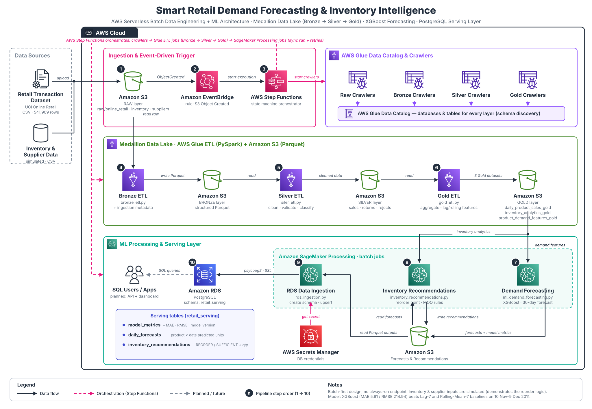

# Smart Retail Demand Forecasting & Inventory Intelligence

> **An end-to-end AWS data engineering and machine-learning project for retail demand forecasting and inventory replenishment recommendations.**

This README is written as both a project document and a learning guide. It explains the business problem, why the system is designed this way, how data moves through the AWS architecture, what each source-code module does, how the forecasting and inventory calculations work.

---

## Table of contents

1. [Project at a glance](#1-project-at-a-glance)
2. [Problem statement](#2-problem-statement)
3. [Proposed solution](#3-proposed-solution)
4. [Project scope](#4-project-scope-implemented-vs-planned)
5. [Data sources and assumptions](#5-data-sources-and-assumptions)
6. [System architecture](#6-system-architecture)
7. [Architecture design: why each service is used](#7-architecture-design-why-each-service-is-used)
8. [End-to-end workflow](#8-end-to-end-workflow)
9. [Data lake and medallion architecture](#9-data-lake-and-medallion-architecture)
10. [ETL implementation](#10-etl-implementation)
11. [Data quality and business rules](#11-data-quality-and-business-rules)
12. [Feature engineering](#12-feature-engineering)
13. [Demand forecasting with XGBoost](#13-demand-forecasting-with-xgboost)
14. [Inventory intelligence and reorder calculations](#14-inventory-intelligence-and-reorder-calculations)
15. [PostgreSQL serving layer](#15-postgresql-serving-layer)
16. [Technology stack](#16-technology-stack)
17. [Configuration and execution requirements](#17-configuration-and-execution-requirements)
18. [Security, reliability and AWS cost considerations](#18-security-reliability-and-aws-cost-considerations)
19. [Limitations and design decisions](#19-limitations-and-design-decisions)
20. [Future enhancements](#20-future-enhancements)


---

# 1. Project at a glance

Retail demand changes over time. A product may sell quickly during one period and slowly during another. If a retailer orders too much, money is tied up in unsold inventory. If the retailer orders too little, products may become unavailable when customers want them.

This project builds a batch-oriented cloud data pipeline that:

1. Stores source retail data in Amazon S3.
2. Uses AWS Glue to transform raw records into structured Bronze, Silver and Gold datasets.
3. Creates daily product-level sales and demand features.
4. Uses an XGBoost regression model to forecast product demand for the next 30 days.
5. Combines forecasts with inventory and supplier assumptions to calculate reorder recommendations.
6. Loads model metrics, forecasts and recommendations into Amazon RDS for PostgreSQL.

**Primary focus:** AWS cloud data engineering.

**Supporting focus:** machine learning, time-series feature engineering, inventory business rules and relational database design.

## Architecture preview



The architecture image is a high-level view. The detailed explanation below describes the responsibilities and sequence of the actual components.

---

# 2. Problem statement

## 2.1 Business problem

Retail businesses must maintain enough inventory to meet customer demand without holding unnecessary stock.

Two common problems are:

- **Overstocking:** more units are held than are likely to be sold. This increases storage costs and ties up working capital.
- **Understocking:** available stock is insufficient to meet demand. This can result in missed sales and a poor customer experience.

Historical sales data can help estimate future demand. However, transaction files alone do not directly provide a clean, product-level demand history or a replenishment decision. The data must be ingested, cleaned, aggregated and analysed. Forecasts must then be combined with inventory information and supplier lead-time assumptions.

## 2.2 Technical problem

The project addresses the following data and analytics challenges:

- Retail records arrive as source files and need a repeatable ingestion process.
- Transaction records may contain cancellations, returns, missing values and invalid values.
- Daily demand must be calculated at product level.
- Forecasting features must be created without using future information.
- Forecasts need to be evaluated against simple baselines.
- Demand estimates must be converted into understandable replenishment recommendations.
- Results need to be stored in a database for later querying.

## 2.3 Project objectives

- Build a batch ingestion and processing workflow on AWS.
- Store data in an S3 data lake.
- Use AWS Glue and PySpark for ETL.
- Organise data using Bronze, Silver and Gold layers.
- Generate daily product sales and demand features.
- Train and evaluate an XGBoost demand forecasting model.
- Generate a 30-day daily forecast.
- Calculate reorder points and suggested order quantities.
- Store metrics, forecasts and recommendations in PostgreSQL on Amazon RDS.
- Orchestrate processing using EventBridge and Step Functions.

---

# 3. Proposed solution

The solution separates the problem into data engineering, machine learning, inventory logic and data serving.

| Stage | What happens | Why it is needed |
|---|---|---|
| Data ingestion | Source files are placed in S3 | Creates a central landing area |
| Bronze ETL | Source data is read and stored in structured form | Preserves an ingested representation |
| Silver ETL | Records are cleaned, validated and separated by business meaning | Makes data reliable for analysis |
| Gold ETL | Daily sales and demand features are generated | Creates analytics- and ML-ready data |
| Demand forecasting | XGBoost predicts future daily product demand | Estimates future demand |
| Inventory intelligence | Forecasts are combined with stock and supplier assumptions | Converts demand into reorder guidance |
| Data serving | Outputs are loaded into PostgreSQL | Makes results available for querying |

The workflow is batch-first. It is designed to process a dataset or a new batch of data, not to make millisecond-level predictions for every transaction.

---

# 4. Project scope: 


## 4.1 Components 

| Component | Evidence in the supplied project |
|---|---|
| S3-based storage | ETL and ML scripts use S3 locations |
| Event-driven workflow start | Step Functions definition is configured around an S3 object-created event through EventBridge |
| Step Functions orchestration | State machine definition coordinates crawlers, Glue jobs and SageMaker Processing jobs |
| Glue Crawlers and Data Catalog | State machine starts raw, Bronze, Silver and Gold crawler groups |
| Bronze/Silver/Gold ETL | `bronze_etl.py`, `siler_etl.py`, `gold_etl.py` |
| Demand forecasting | `ml_demand_forecasting.py` uses XGBoost and baseline comparisons |
| Inventory recommendations | `inventory_recommendations.py` calculates reorder-related values |
| PostgreSQL data loading | `rds_ingestion.py` creates serving tables and loads outputs |
| Secrets Manager integration | RDS ingestion code retrieves database credentials from Secrets Manager |


# 5. Data sources and assumptions

## 5.1 Primary transaction dataset

The project blueprint identifies the **UCI Online Retail** dataset as the primary transaction source.

Dataset: [UCI Online Retail](https://archive.ics.uci.edu/dataset/352/online+retail)

The blueprint describes the dataset as historical transactions from a UK-based non-store online retailer covering 1 December 2010 through 9 December 2011, with 541,909 transaction records.

Relevant fields include:

| Field | Meaning | Project use |
|---|---|---|
| `InvoiceNo` | Invoice identifier | Identify cancellation invoices |
| `StockCode` | Product identifier | Group transactions by product |
| `Description` | Product description | Product information |
| `Quantity` | Units on the transaction line | Calculate units sold and identify returns |
| `InvoiceDate` | Transaction date/time | Build daily time series |
| `UnitPrice` | Unit price | Revenue analysis and validation |
| `CustomerID` | Customer identifier | Optional customer-level analysis |
| `Country` | Customer country | Descriptive analysis |

The exact dataset version and actual file supplied to the pipeline should be checked before making claims about record counts or date coverage in a live run.

## 5.2 Supporting inventory and supplier data

The transaction dataset does not provide a current stock snapshot, supplier lead times, safety stock or minimum order quantities. The project therefore uses supporting inventory and supplier records that are identified as simulated in the recommendation logic.

Typical fields include:

| Field | Meaning |
|---|---|
| `product_id` | Product identifier linked to the retail product |
| `current_stock` | Assumed stock currently available |
| `supplier_id` | Assigned supplier |
| `supplier_lead_time_days` | Assumed replenishment lead time |
| `safety_stock` | Additional buffer stock |
| `minimum_order_quantity` | Minimum quantity accepted for an order |
| `reorder_multiple` | Required order quantity multiple |
| `snapshot_date` | Date represented by the inventory snapshot |

**Important:** recommendations based on simulated inventory and supplier values are demonstrations of the calculation logic. They are not verified live stock recommendations.

## 5.3 Data limitations

- The sales dataset is historical and may not represent current retail demand.
- It represents one retailer and its historical product mix.
- Current inventory and supplier data are simulated.
- Sales-only records do not provide confirmed stockout labels.
- Products with sparse or intermittent sales can be difficult to forecast reliably.

---

# 6. System architecture

## 6.1 Logical architecture

```text
Retail transaction data             Product / supplier / inventory data
           |                                      |
           +------------------+-------------------+
                              |
                              v
                    Amazon S3 - raw/
                              |
                    S3 object-created event
                              |
                         EventBridge
                              |
                       AWS Step Functions
                              |
              +---------------+----------------+
              |                                |
       AWS Glue Crawlers                 AWS Glue ETL
       / Glue Data Catalog              Bronze -> Silver -> Gold
              |                                |
              +---------------+----------------+
                              |
                       Gold datasets in S3
                              |
                   SageMaker Processing jobs
                              |
               +--------------+----------------+
               |                               |
        Demand forecasting             Inventory recommendations
               |                               |
               +--------------+----------------+
                              |
                       Output data in S3
                              |
                    RDS ingestion process
                              |
                    Amazon RDS PostgreSQL
                              |
                   SQL queries / future API
```

The supplied Step Functions definition contains the detailed orchestration sequence. The Python scripts implement the data transformations and processing logic.

## 6.2 Main data flow

1. Source data is uploaded to the S3 raw area.
2. An S3 object-created event is routed through EventBridge to start the Step Functions workflow.
3. Raw crawlers discover source schemas and update the Glue Data Catalog.
4. The Bronze Glue ETL job processes source data.
5. Bronze crawlers register the Bronze datasets.
6. The Silver Glue ETL job cleans and validates data.
7. Silver crawlers register the Silver datasets.
8. The Gold Glue ETL job creates daily sales aggregates and demand features.
9. Gold crawlers register the Gold datasets.
10. SageMaker Processing runs the forecasting, inventory recommendation and RDS loading stages in sequence.
11. PostgreSQL stores the model metrics, daily forecasts and inventory recommendations.

## 6.3 Architecture design principles

- **Separation of responsibilities:** ingestion, ETL, forecasting, recommendation calculation and database loading are separate stages.
- **Durable storage:** S3 stores the data lake layers and processing outputs.
- **Metadata management:** Glue Crawlers and the Glue Data Catalog make datasets discoverable to downstream jobs.
- **Orchestration:** Step Functions controls execution order and waits for managed jobs to finish.
- **Batch processing:** SageMaker Processing runs scripts as jobs instead of requiring an always-on inference endpoint.
- **Serving layer:** PostgreSQL stores the smaller set of application-ready outputs rather than the entire data lake.

---

# 7. Architecture design: why each service is used

## Amazon S3 — data lake storage

S3 stores source files, transformed datasets, processing scripts and model outputs.

Why it is used:
- Separates storage from compute.
- Supports large files and Parquet datasets.
- Allows Glue and SageMaker to read and write data.
- Preserves the raw source for reprocessing.

A bucket name is not an access credential. Access is controlled by IAM policies, bucket policies, encryption and public-access settings.

## Amazon EventBridge — event routing

EventBridge receives the configured S3 object-created event and starts the workflow.

Why it is used:
- Avoids manually starting every workflow run.
- Connects an S3 event to the orchestration layer.
- Keeps event routing separate from ETL code.

## AWS Step Functions — workflow orchestration

Step Functions coordinates the order of AWS jobs.

Why it is used:
- Defines dependencies between processing stages.
- Supports parallel execution for independent crawlers.
- Waits for Glue and SageMaker jobs to complete.
- Supports retries for configured failures.
- Provides execution history for troubleshooting.

## AWS Glue Crawlers and Data Catalog — metadata discovery

A crawler examines data in S3 and creates or updates table metadata in the Glue Data Catalog.

Why it is used:
- Discovers schema and data locations.
- Makes tables available to Glue jobs and compatible query services.
- Reduces the need to manually define every discovered schema.

A crawler catalogs data; it does not perform the full cleaning and business transformation that the ETL jobs perform.

## AWS Glue ETL — data transformation

Glue runs the Bronze, Silver and Gold transformation jobs.

Why it is used:
- Managed Spark/PySpark execution.
- Suitable for distributed data transformations.
- Integrates with S3 and the Glue Data Catalog.

## Amazon SageMaker Processing — Python processing jobs

SageMaker Processing runs the supplied Python scripts in managed processing containers.

Why it is used:
- Runs data science and ML processing code in managed jobs.
- Can access S3 inputs and outputs.
- Does not require a continuously running model endpoint for batch work.

The supplied state machine configures one `ml.t3.medium` instance and a 5 GB processing volume for each of its SageMaker Processing tasks. These are configuration values in the workflow, not a general recommendation for every dataset.

## Amazon RDS for PostgreSQL — serving database

RDS stores the final outputs that need relational querying.

Why it is used:
- Supports structured tables and SQL queries.
- Supports keys, constraints and indexes.
- Can serve downstream applications if an API is added later.

## AWS Secrets Manager — credential storage

The RDS ingestion script retrieves database credentials from Secrets Manager instead of requiring a database password to be embedded in the repository.

---

# 8. End-to-end workflow

The supplied state machine groups crawlers by data layer and runs the Glue and SageMaker stages in order.

## 8.1 Crawler stages

The state machine has:
- 4 raw crawler branches.
- 4 Bronze crawler branches.
- 7 Silver crawler branches.
- 3 Gold crawler branches.

Each crawler branch starts a crawler, waits 15 seconds, checks its state and repeats the wait/check cycle until the crawler reports `READY`.

The parallel state allows independent crawlers in the same stage to run concurrently.

## 8.2 Glue ETL stages

The state machine runs:
1. `project_bronze_layer`
2. `project_silver_layer`
3. `project_gold_layer`

The Glue integration uses the synchronous job-run pattern, so the workflow waits for the Glue job to finish before moving to the next stage.

The ETL tasks have retry configuration for selected failures, with a 30-second initial interval, up to 3 attempts and exponential backoff.

## 8.3 SageMaker Processing stages

The state machine runs three SageMaker Processing jobs in sequence:

1. Model-training stage.
2. Batch-inference stage.
3. RDS-injection stage.

The state machine's configured script filenames differ from the local Python filenames in the supplied ZIP. You confirmed that the uploaded source files are the real project files and the names differ. When deploying, ensure the objects and entrypoint paths in S3 match the actual uploaded script names.

The local source modules supplied for this project are:
- `ml_demand_forecasting.py`
- `inventory_recommendations.py`
- `rds_ingestion.py`

The recommendation module is a distinct part of the local source set. Verify that the deployed Processing job sequence invokes it at the correct point before the RDS ingestion stage.

---

# 9. Data lake and medallion architecture

A medallion architecture separates data by its level of processing.

```text
                 RAW SOURCE FILES
                        |
                        v
                 +-------------+
                 |   BRONZE    |
                 | Ingested    |
                 | structured  |
                 | data        |
                 +-------------+
                        |
                        v
                 +-------------+
                 |   SILVER    |
                 | Cleaned     |
                 | validated   |
                 | data        |
                 +-------------+
                        |
                        v
                 +-------------+
                 |    GOLD     |
                 | Aggregated  |
                 | analytics & |
                 | ML features |
                 +-------------+
                        |
                        v
              Forecasting and inventory
                   recommendations
```

## 9.1 Raw layer

Purpose: keep the source inputs available.

The raw layer should preserve source files rather than silently changing business values.

Typical source areas include:
- `raw/online_retail/`
- `raw/inventory/`
- `raw/suppliers/`

## 9.2 Bronze layer

Purpose: preserve ingested data in a structured format.

The supplied Bronze ETL adds ingestion metadata to transaction data and writes Parquet datasets to S3.

Metadata such as ingestion time and source file helps answer:
- When was the data loaded?
- Which source file produced this record?
- Which ingestion batch should be investigated if a problem occurs?

## 9.3 Silver layer

Purpose: create clean and validated records.

This layer handles:
- Data type conversion.
- Transaction classification.
- Product, supplier and inventory cleaning.
- Invalid-record separation.
- Rejected-record reasons.
- Latest inventory snapshot selection.

## 9.4 Gold layer

Purpose: create data that is ready for analytics and model features.

The supplied Gold job creates:
- `daily_product_sales_gold`
- `inventory_analytics_gold`
- `product_demand_features_gold`

These datasets provide daily demand, inventory information and time-series features for the next processing stages.

---

# 10. ETL implementation

The source repository contains three Glue ETL scripts.

## 10.1 `bronze_etl.py`

Responsibilities:
1. Read the Online Retail CSV input.
2. Read product, supplier and inventory data through Glue Data Catalog tables.
3. Add ingestion metadata such as ingestion timestamp and source file to transaction data.
4. Write structured Parquet outputs to the S3 Bronze layer.

**Why Bronze exists:** it creates a traceable, structured representation of what entered the pipeline. If a later transformation rule changes, the pipeline can be reprocessed from earlier data.

## 10.2 `siler_etl.py`

The supplied filename is spelled `siler_etl.py`. Keep this spelling consistent with the deployed Glue job unless you rename the file and update the job configuration.

Responsibilities:
1. Read Bronze datasets.
2. Clean and cast transaction fields.
3. Separate sales, returns, cancellations and rejected records.
4. Record rejection reasons for invalid records.
5. Clean product and supplier information.
6. Clean inventory records and retain the latest inventory snapshot for each product.
7. Write Silver outputs.

**Why Silver exists:** downstream calculations should not need to repeatedly interpret raw cancellations, returns, invalid values and inconsistent types.

## 10.3 `gold_etl.py`

Responsibilities:
1. Aggregate daily product sales.
2. Build a product-date grid.
3. Create lag features.
4. Create rolling demand statistics.
5. Join product, supplier and inventory information.
6. Write the three Gold analytics datasets.

**Why Gold exists:** the forecasting job needs consistent product-level time-series rows, not raw invoice lines.

---

# 11. Data quality and business rules

Retail transaction records need business-aware handling. A negative quantity is not necessarily an ordinary sale, and a cancellation should not be counted as positive demand.

| Data condition | Interpretation / handling |
|---|---|
| Invoice number begins with `C` | Cancellation indicator; separate from normal sales |
| Negative quantity | May represent a return; track separately |
| Positive quantity on a valid sale | Candidate for gross demand |
| Missing product identifier | Cannot reliably assign the transaction to a product; reject or quarantine |
| Missing customer identifier | Does not automatically make the transaction unusable for product/date demand |
| Invalid price | Flag for validation rather than silently treating it as valid revenue |
| Duplicate transaction lines | Apply a documented duplicate rule and retain audit counts |

## Why rejected records matter

Rejected data should not simply disappear. Keeping rejected records and their reasons helps identify:
- Source data problems.
- Schema changes.
- Unexpected values.
- Transformation bugs.

## Important forecasting rule

Returns and cancellations should not be silently mixed into positive sold quantity. The forecast target must be defined consistently. In this project, the demand model uses positive sold quantity as its target, while returns and cancellations are handled separately in the cleaning process.

---

# 12. Feature engineering

Machine-learning models require numerical inputs that describe the information available at the time a prediction is made.

The Gold feature dataset uses historical demand information and calendar information.

## 12.1 Lag features

A lag feature is a previous value of the target series.

| Feature | Meaning |
|---|---|
| `sales_lag_1` | Product demand one day earlier |
| `sales_lag_7` | Product demand seven days earlier |
| `sales_lag_14` | Product demand fourteen days earlier |
| `sales_lag_28` | Product demand twenty-eight days earlier |

Example: if the model predicts demand for 15 October, `sales_lag_7` represents demand on 8 October.

## 12.2 Rolling features

A rolling feature summarises demand over a previous time window.

Examples:
- 7-day rolling mean.
- 28-day rolling mean.
- 7-day rolling standard deviation.

A rolling average can smooth short-term variation. Rolling standard deviation can describe how variable recent demand has been.

## 12.3 Calendar features

Calendar features help a model learn recurring time patterns.

Examples:
- Day of week.
- Month.
- Weekend indicator.

## 12.4 Preventing data leakage

**Data leakage** occurs when the model receives information that would not have been available at prediction time.

For example, when predicting demand for a particular date, that date's actual sales must not be included in its own rolling average.

Lag and rolling features must be shifted so that only information from earlier dates is used.

This is one of the most important correctness checks in time-series machine learning.

## 12.5 Missing dates and zero demand

A missing product-date row is not automatically a zero-sales day.

Fill a missing date with zero demand only when the dataset coverage confirms that the date was observed and no sale occurred. Otherwise, the value may be unknown rather than zero.

---

# 13. Demand forecasting with XGBoost

## 13.1 Forecasting objective

The model estimates daily product demand for future dates.

The supplied forecasting script generates a 30-day forecast horizon.

The prediction target is positive sold quantity per product per day, based on the cleaned transaction history.

A forecast is an estimate, not a guarantee of future sales.

## 13.2 What is XGBoost?

XGBoost is a gradient-boosted decision-tree library. It builds a sequence of trees where later trees attempt to correct errors made by earlier trees.

Why it can be useful here:
- It works well with tabular feature sets.
- It can learn nonlinear relationships.
- It can combine lag, rolling and calendar features.
- It provides a practical model for a structured demand forecasting problem.

It does not automatically understand time order. Time-series features and chronological evaluation must be designed correctly.

## 13.3 Model workflow 

`ml_demand_forecasting.py`:
1. Reads the Gold demand feature dataset.
2. Prepares lag, rolling and calendar features.
3. Trains an XGBoost regression model.
4. Evaluates the model using MAE and RMSE.
5. Compares it with simple lag-7 and rolling-mean-7 baselines.
6. Generates daily forecasts for 30 days.
7. Writes forecast and metric outputs to S3.

## 13.4 Baseline models

A baseline is a simple method used as a reference point.

The supplied code compares XGBoost against:
- **Lag-7 baseline:** uses demand from seven days earlier.
- **Rolling-mean-7 baseline:** uses a recent seven-day average.

A complex model is not automatically better. If XGBoost does not outperform a reasonable baseline, the features, training setup or model may need improvement.

## 13.5 Evaluation metrics

### Mean Absolute Error (MAE)

MAE is the average absolute difference between actual and predicted values.

\[
MAE = \frac{1}{n}\sum_{i=1}^{n}|y_i-\hat{y}_i|
\]

It is interpretable in the same units as the target, such as units sold.

### Root Mean Squared Error (RMSE)

\[
RMSE = \sqrt{\frac{1}{n}\sum_{i=1}^{n}(y_i-\hat{y}_i)^2}
\]

RMSE penalises large errors more heavily than MAE.

The supplied script uses MAE and RMSE. Additional metrics such as WAPE and forecast bias are possible future improvements, but should not be described as implemented unless added to the code.

## 13.6 Final model evaluation results

The following are the final metrics provided from the project's evaluation run.

**Evaluation period:** 10 November 2011 to 9 December 2011  
**Number of test rows:** 147,480  
**Model version:** `xgboost_demand_v1`

| Model | MAE | RMSE |
|---|---:|---:|
| XGBoost | **5.913619** | **214.943419** |
| Lag-7 Baseline | 6.638202 | 218.430330 |
| Rolling Mean-7 Baseline | 6.142768 | 215.410693 |

### Interpretation

- XGBoost achieved the lowest MAE and RMSE among the three evaluated models.
- Its MAE was approximately **10.92% lower** than the Lag-7 baseline.
- Its MAE was approximately **3.73% lower** than the Rolling Mean-7 baseline.
- Its RMSE was approximately **1.60% lower** than the Lag-7 baseline and **0.22% lower** than the Rolling Mean-7 baseline.

These results show that XGBoost performed best on this particular evaluation period and test set. They do not prove that it will perform best on every future period or on a different retailer's data.

### Important observation about RMSE

The RMSE values are much larger than the corresponding MAE values. Since RMSE penalises large errors more heavily, this can indicate that a smaller number of records have very large prediction errors. Investigate the largest residuals, high-volume products, target distribution and forecast/actual joins before concluding why this difference occurs.

The metrics should be interpreted in the same units as the prediction target. If the target is units sold per product-day, MAE is the average absolute error in those units.

## 13.7 Why chronological validation matters

For time-series forecasting, randomly splitting rows can allow future records to influence training while earlier records are used for testing.

A chronological split trains on earlier dates and evaluates on later dates. This better represents the real task: using the past to predict the future.

## 13.8 Forecast output

The output should be interpretable at product and forecast-date level. A useful forecast record includes:
- Product identifier.
- Forecast date.
- Predicted units.
- Model version or run information, where available.

The actual output schema should be checked against the script and database loader before downstream consumers are built.

---

# 14. Inventory intelligence and reorder calculations

Forecasting estimates demand. Inventory intelligence uses that demand estimate together with stock and supplier assumptions to calculate replenishment guidance.

This is a **rule-based calculation layer**, not a second machine-learning model.

## 14.1 Main input values

- Forecast demand.
- Current stock.
- Supplier lead time.
- Safety stock.
- Minimum order quantity (MOQ).
- Reorder multiple.

## 14.2 Expected demand during lead time

Lead time is the number of days between placing an order and receiving it.

If a supplier takes five days to deliver, the business needs enough stock to cover expected demand during those five days.

\[
LeadTimeDemand = \sum_{d=1}^{L} ForecastDemand_d
\]

where \(L\) is the supplier lead time in days.

## 14.3 Reorder point

The reorder point adds a safety buffer to expected lead-time demand.

\[
ReorderPoint = LeadTimeDemand + SafetyStock
\]

If current stock falls below this point, replenishment may be required.

## 14.4 Target stock and order quantity

The supplied recommendation logic calculates lead-time demand, reorder point, target stock and a raw order quantity. The general design is:

\[
RawOrderQuantity = \max(0, TargetStock - CurrentStock)
\]

The target stock calculation depends on the forecast coverage and inventory policy used by the implementation. The supplied code should be treated as the authority for the exact configured formula.

## 14.5 MOQ and reorder multiple

Some suppliers require:
- A minimum quantity per order.
- Orders in multiples of a fixed number of units.

The recommendation code applies MOQ and reorder-multiple rounding to the raw order quantity.

Keep both the raw quantity and adjusted quantity when explaining a recommendation. This makes the business rule transparent.

## 14.6 Recommendation status

The supplied script assigns statuses such as:
- `REORDER`
- `SUFFICIENT`

It also creates a reason for the recommendation.

## 14.7 Illustrative example

Assume:

| Input | Value |
|---|---:|
| Average forecast daily demand | 10 units |
| Supplier lead time | 5 days |
| Safety stock | 15 units |
| Current stock | 40 units |

Expected lead-time demand:

\[
10 \times 5 = 50 \text{ units}
\]

Reorder point:

\[
50 + 15 = 65 \text{ units}
\]

Current stock is 40 units, which is below the reorder point of 65. Under this illustrative policy, the product should be flagged for replenishment.

This is an example to explain the formula, not a claim about an actual product in the dataset.

## 14.8 Why simulated inventory must be disclosed

The sales dataset does not provide actual current stock, supplier lead times or purchasing constraints. Those values are simulated. Therefore:
- The project demonstrates how replenishment logic works.
- The results are not verified purchasing instructions.
- A real deployment would need reliable inventory snapshots and supplier data.

---

# 15. PostgreSQL serving layer

The RDS ingestion script creates a PostgreSQL schema named `retail_serving`.

It creates three serving tables.

| Table | Purpose |
|---|---|
| `retail_serving.model_metrics` | Stores model evaluation information such as MAE and RMSE |
| `retail_serving.daily_forecasts` | Stores product-level daily forecast records |
| `retail_serving.inventory_recommendations` | Stores calculated inventory and reorder recommendations |

## Why use PostgreSQL after S3?

S3 is suitable for data lake storage and large analytical files. PostgreSQL is suitable for structured records that need relational queries.

The project therefore uses:
- **S3** for raw, transformed and analytical datasets.
- **PostgreSQL** for the smaller set of model and recommendation outputs that downstream applications or SQL users need.

## Database loading

`rds_ingestion.py`:
1. Creates or prepares the `retail_serving` schema and tables.
2. Retrieves credentials from AWS Secrets Manager.
3. Reads the required Parquet outputs from S3.
4. Connects to PostgreSQL using SSL.
5. Inserts or upserts records into the serving tables.

The exact columns and conflict keys should be verified in the current SQL definitions in the script before writing external queries against the tables.

---


### File responsibilities

| File | Responsibility |
|---|---|
| `bronze_etl.py` | Reads source data and writes Bronze datasets |
| `siler_etl.py` | Cleans and validates data for the Silver layer |
| `gold_etl.py` | Creates daily sales, inventory analytics and demand features |
| `ml_demand_forecasting.py` | Trains/evaluates XGBoost and generates 30-day forecasts |
| `inventory_recommendations.py` | Calculates reorder points, target stock and order recommendations |
| `rds_ingestion.py` | Loads metrics, forecasts and recommendations into PostgreSQL |
| `requirements.txt` | Lists Python package dependencies |


---

# 16. Technology stack

| Category | Technology | Use |
|---|---|---|
| Cloud storage | Amazon S3 | Data lake and script/output storage |
| Event routing | Amazon EventBridge | Routes the S3 object-created event |
| Orchestration | AWS Step Functions | Coordinates the processing workflow |
| Data engineering | AWS Glue | Managed ETL |
| Data catalog | AWS Glue Data Catalog | Table metadata |
| Distributed processing | PySpark | ETL transformations |
| Machine learning | XGBoost | Demand forecasting |
| Processing jobs | Amazon SageMaker Processing | Runs Python processing scripts |
| Database | Amazon RDS for PostgreSQL | Stores final metrics and outputs |
| Credentials | AWS Secrets Manager | Database credential retrieval |
| AWS SDK | Boto3 | AWS service interaction |
| Data access | AWS Data Wrangler / PyArrow | S3 and Parquet operations |
| Database driver | psycopg2 | PostgreSQL connection and loading |

The exact dependency versions are listed in `requirements.txt`.

---

# 17. Configuration and execution requirements

This repository documents the project source. It does not automatically create all AWS resources. The AWS environment must be configured to match the scripts and state machine.

## 17.1 Requirements

- An AWS account.
- An S3 bucket with the expected source and output prefixes.
- IAM roles with permissions for S3, Glue, Step Functions, SageMaker Processing, RDS access and Secrets Manager.
- Glue databases, crawlers and ETL jobs configured for the expected inputs and outputs.
- A Step Functions state machine configured with the correct job names and script entrypoints.
- A SageMaker Processing execution role.
- An Amazon RDS for PostgreSQL instance reachable from the processing environment.
- A Secrets Manager secret containing the database connection credentials.
- Python environment compatible with the versions pinned in `requirements.txt`.

## 17.2 Install dependencies

```bash
python -m pip install -r requirements.txt
```

Some scripts are designed to run inside AWS Glue or SageMaker Processing. Installing dependencies locally does not by itself reproduce the AWS execution environment.

## 17.3 Configuration checklist

Before running the workflow, verify:

1. **S3 bucket configuration:** Glue ETL scripts receive a bucket name through job arguments; ML and database scripts also contain bucket configuration that must match the target environment.
2. **AWS Region:** S3, Glue, SageMaker, RDS and Secrets Manager resources must use the intended region and compatible network configuration.
3. **Glue Catalog:** databases, tables and crawler targets must match the data paths expected by the ETL jobs.
4. **Job arguments:** Glue job arguments and script paths must match the actual source code.
5. **SageMaker Processing inputs:** the S3 script prefix and container entrypoints must point to the intended files.
6. **Job order:** inventory recommendation output must exist before the RDS ingestion job attempts to load it.
7. **PostgreSQL connectivity:** network rules must allow the processing environment to connect to the database.
8. **Secrets Manager:** the configured secret must contain the expected database fields and be readable by the execution role.

Do not commit access keys, passwords, secret values or private database credentials to GitHub.

## 17.4 Source-code checks before execution

The uploaded source ZIP was reviewed and the following issues were identified:

- In `inventory_recommendations.py`, the forecast-reading function constructs an S3 path but passes `sys.path` to the Parquet reader instead of the intended S3 path variable.
- In `inventory_recommendations.py`, the output write uses `output_path`, which is not defined in the uploaded file. Define the intended S3 destination and make it match the path expected by the RDS ingestion script.
- In `rds_ingestion.py`, the Boto3 session is referenced to create AWS clients before the session is initialized. Initialize the session before creating those clients.

These should be fixed and tested before treating the full workflow as a successful end-to-end run.

---


# 18. Security, reliability and AWS cost considerations

## 18.1 Security

- Keep S3 buckets private unless public access is specifically required.
- Enable S3 Block Public Access for buckets that do not need public access.
- Use IAM roles with least-privilege permissions.
- Keep AWS credentials and database passwords out of GitHub.
- Store database credentials in Secrets Manager.
- Restrict RDS network access to the required security group or network path.
- Do not upload screenshots containing account identifiers, credentials, secret values or private data.

A bucket name is not a password. The security boundary is the permission configuration.

## 18.2 Reliability

- Use retries for transient errors where safe.
- Make output writes repeatable or protect them with run identifiers.
- Validate upstream data before launching dependent jobs.
- Keep rejected records and error information for debugging.
- Check the last successful output before replacing it with a failed run's incomplete result.

## 18.3 AWS cost

AWS services can incur charges. Glue, SageMaker Processing, RDS, S3 storage/requests, data transfer and related services may all contribute to cost.

Practical controls:
- Test transformations locally on a small sample first.
- Use Parquet to reduce analytical scan volume.
- Avoid leaving RDS or compute resources running when they are not needed.
- Prefer batch processing over an always-on endpoint for this project.
- Set AWS Budgets and billing alerts.
- Delete unused test resources and data when appropriate.

---

# 19. Limitations and design decisions

## Historical data

The source transaction dataset is historical. A model trained on it cannot automatically represent current retail conditions.

## Simulated inventory and supplier information

The recommendation logic uses simulated inventory and supplier values. The recommendations demonstrate a method, not a verified operational purchasing plan.

## Stockout prediction

The current project forecasts demand and applies inventory rules. It does not train a supervised stockout prediction model using confirmed stockout labels.

A genuine stockout model would need historical stock snapshots, stock movements, purchase orders, replenishment dates and labelled stockout events.

## Batch rather than real-time

The project uses batch processing because the source data is historical and the intended output is a periodic forecast. A continuously running real-time endpoint is not required for the current scope.

## Application layer

The blueprint describes a FastAPI backend and React dashboard, but those components are not included in the supplied source files. They are future extensions, not current features.

---

# 20. Future enhancements

Possible improvements after the current pipeline is stable:

1. Add an API to serve forecasts and recommendations.
2. Add a dashboard for product demand, model metrics and inventory risk.
3. Replace simulated inventory and supplier data with validated operational feeds.
4. Add WAPE and forecast bias metrics.
5. Evaluate performance separately for high-volume and intermittent-demand products.
6. Add forecast confidence intervals.
7. Add model version tracking and controlled retraining.
8. Add data-quality monitoring and CloudWatch alarms.
9. Add notifications for failed pipeline executions.
10. Add automated tests and deployment workflows.

These are extensions, not claims about the current implementation.

---


